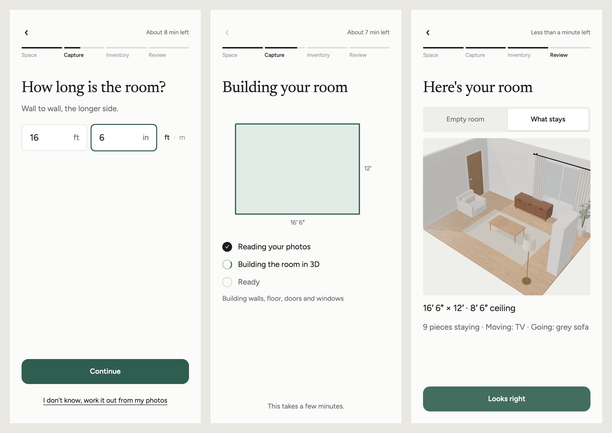
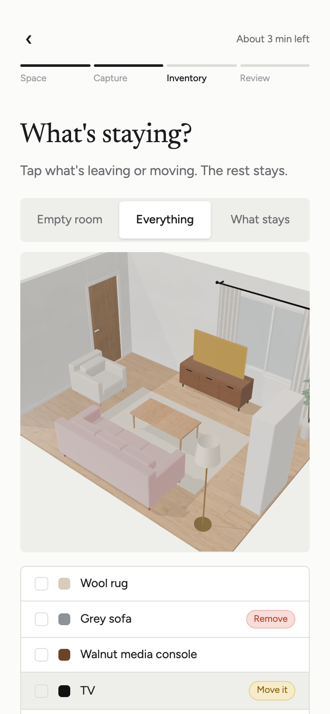
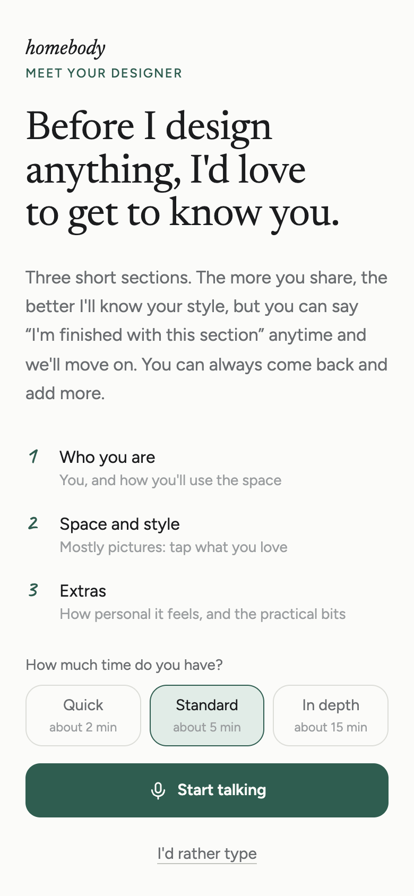
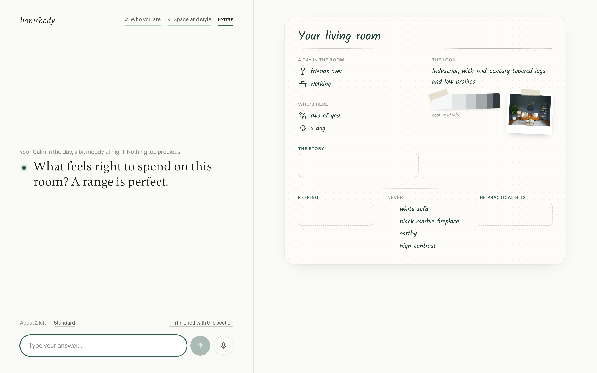
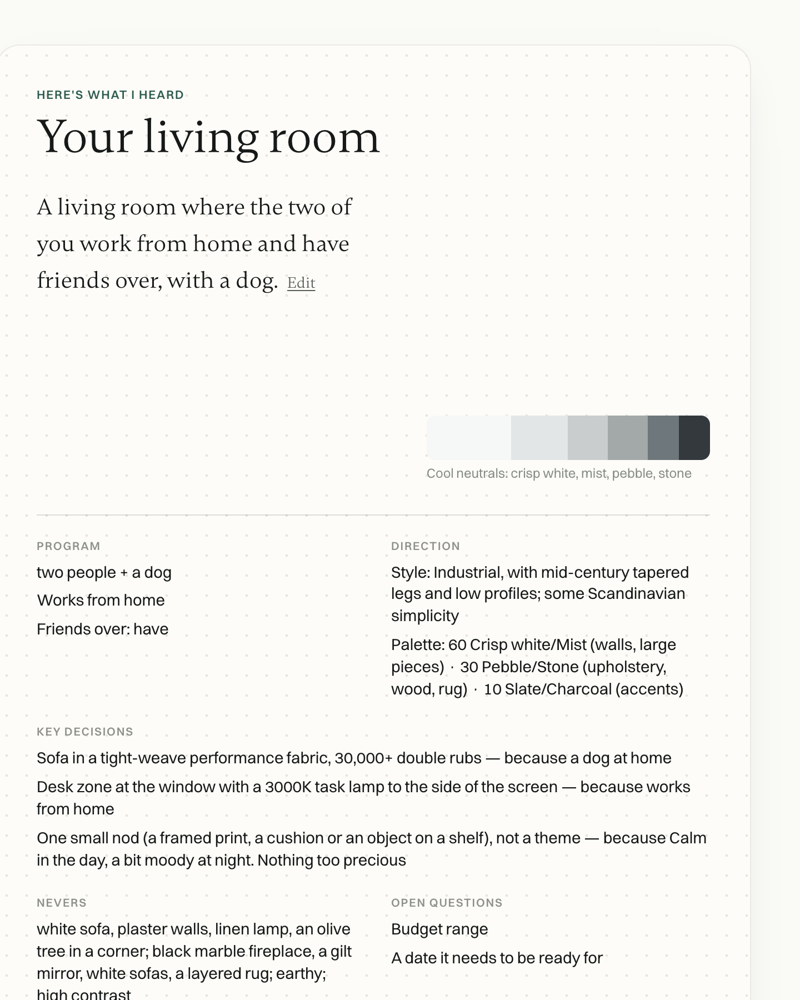
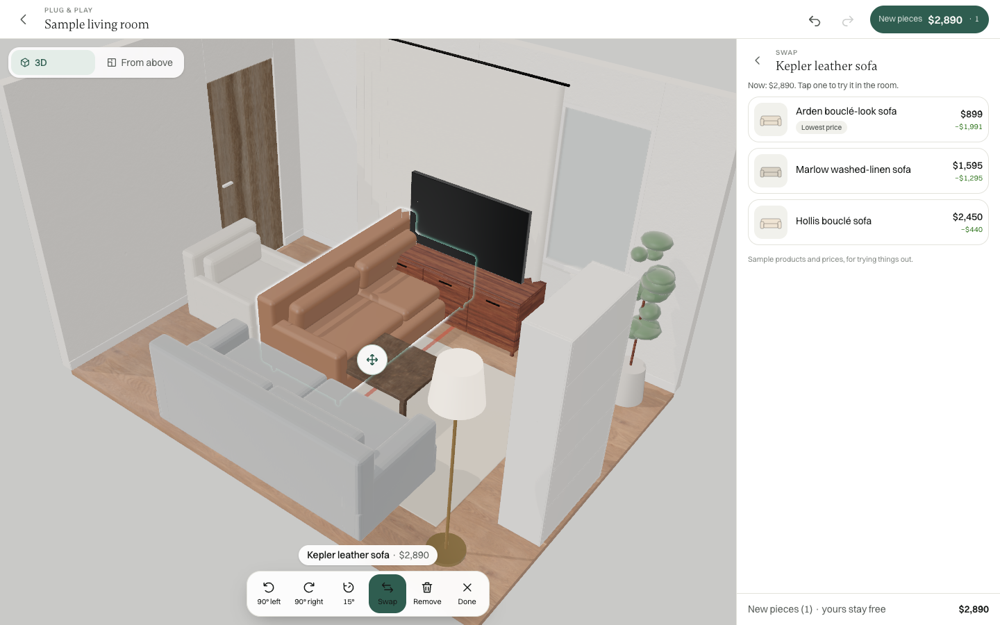
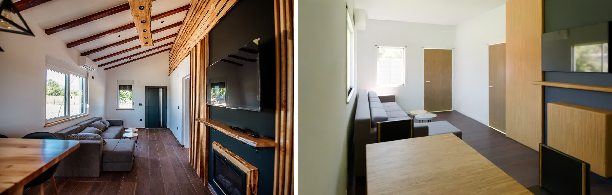

# The room has to be the size you said it was

*Four days into building Homebody, an AI interior designer, with Claude Code running in a loop and a critic agent
that keeps saying no.*

I'm building Homebody. The goal is to give anyone the experience of hiring a polished, thoughtful interior
designer. It has four pieces, each with a code name:

- **Space Capture:** your room, rebuilt to scale in 3D;
- **Taste Builder:** a designer's intake conversation that ends in a brief;
- **Plug & Play:** a 3D editor that works like a game;
- **Transaction:** buying room by room. It isn't built yet.

## The bug that set the bar

After my first demo walkthrough I gave nine notes. One was simple: ask me for a couple of measurements, each with an
"I don't know" option. The agents built it. The design critic then walked the flow on a phone, typed 16′ 6″ × 12′,
and the review screen said "14 × 10 ft".

The sample build was dropping the measurement. With real photos, the size only reached the model as a hint. In the
critic's words: "We now ask two questions and then show a different answer."

The fix, `fitToSides`, rescales the room's footprint to the typed sides before Blender builds
anything. The critic re-read the saved room (5.029 × 3.658 m) and the review now says "16′ 6″ × 12′ · 8′ 6″
ceiling". While the room builds, the screen draws the floor outline at the size you typed, so the wait shows you
something true.

Then you sort what's already there, on the 3D model: Keep here, Move it, Remove. It was the one part I liked as it
was.

*(Clip: media/02-sort-clip.mp4)*

## Taste Builder, rebuilt twice

The first Taste Builder was a decision tree with 36 questions. It worked, and it felt like a form. I asked for a
conversation instead, like the best voice agents: structured sections, open answers, visual choices for style, and
an "I'm not sure" path that explores through pictures.

Before rebuilding it, an agent researched how designers run intake consultations and how style quizzes learn
taste from images (seven reference files). The critic now also judges as a seasoned interior designer.

Today's version follows my second round of notes. It was still too long, so:

- three sections: who you are, space and style, extras;
- a length choice up front: about 2, 5 or 15 minutes;
- "I'm finished with this section" works anytime, and each section has a stopping point once the design minimum is
  covered.

A notebook fills in beside the conversation as you talk.

The brief at the end was my other complaint. Earlier versions read as "fluffy, substanceless". Now the brief has
fixed sections: Program, Direction, Key decisions, Nevers, Open questions. A filter strips filler like "inviting",
"curated" or "timeless" unless something concrete is behind it. The goal is lines a designer could act on. From an
offline test run: "Sofa in a tight-weave performance fabric, 30,000+ double rubs, because a dog at home."

To be honest about status, this version isn't presentable yet. The critic's verdict today was POLISH. The offline
interpreter still drops facts people give it, and once asked for a budget it had already been told.

## What broke: a fallback nobody could see

The live designer runs on Claude. If a call fails, the page falls back to a free offline interpreter, which is
sensible for a demo.

Today the restructure made the designer's reply schema bigger, and the API started rejecting it as too large to
compile. Every turn failed and fell back to the offline script. Nothing on screen changed, and no usage was logged.
The critic only found it by probing the route directly. Its note: "Nobody could have noticed this from the UI."

The lesson I'm keeping: in development, a fallback has to announce itself. A silent fallback makes a broken feature
look like a weak one.

## Plug & Play, first cut

You can now open the captured room in a 3D editor: drag, rotate, add from a catalog, swap, undo. The running cost counts only what's new, and your own pieces stay free.

*(Clip: media/07-play-clip.mp4)*

What's not there yet:

- The catalog is 34 made-up sample products with illustrative prices, and it's labeled that way in the app.
- New pieces can land on top of existing ones; you can see it in the clip.
- "Same look, for less" swaps barely exist: there's one lookalike pair.
- The room in the editor is flat-lit compared with the Blender renders.

The critic called the interaction model "right and worth keeping". It's still not ready to present.

## The first real-photo test

My own room's photos aren't in yet. So the capture pipeline was tested on three freely licensed photos of real
living rooms from Wikimedia Commons.

The reading is the strong part. For the cabin room it named the mono-pitch ceiling with rafters, the oak battens,
the charcoal TV wall, the live-edge shelf and the shell chairs. It also measured the real colors from the photo. The building is the weak part. The 3D builder only knows flat
ceilings and a handful of generic shapes, so all of that became a massing model.

*Photo: "Stylish living room features a comfortable gray sofa and wooden paneling under a high ceiling" by
Shixart1985, CC BY 2.0, via Wikimedia Commons.*

The gap is the builder's vocabulary, not its eyes.

## How I worked

Claude Code runs Homebody in a loop. A timer fires every 20 minutes. Each time it fires:

1. Claude does the next step.
2. A design-critic agent reviews it.
3. A next-step agent saves a checkpoint and picks what's next.

The details that made it work:

- **A named bar.** The critic's prompt asks: "Could this be presented to Steve Jobs and Jony Ive without apology?"
  Reviews end with a verdict, and later ones with one machine-readable line, such as
  `TASTE BUILDER READY TO PRESENT: NO`. Space Capture took four critic passes to reach its first SHIP, and three more
  after my notes.
- **Checkpoints instead of commits.** There are 20 snapshots, saved to a private git ref, so nothing touches my
  branches.
- **Hard rules up front:** no installs, no commits, never touch secrets, and ask before spending. Live conversation
  calls have a daily cap.
- **Feedback in plain words.** "It looks like it was just developed by an AI thing" became a standing rule in the
  critic's prompt. So did "fluffy, substanceless": notes and briefs must be decisions with reasons.
- **Timeframes unlock autonomy.** "I'm away about 12 hours" turned into three agents working in parallel.

The catch: the loop is only as good as the critic's eyes. It caught the silent fallback, but it took my own
walkthrough to see that the whole product looked generic.

## Next

- A visual pass with new typefaces (the overused defaults are out).
- Pieces that don't overlap when placed in Plug & Play.
- A 3D builder that knows sloped ceilings and battens.
- Then photos of my own room.
